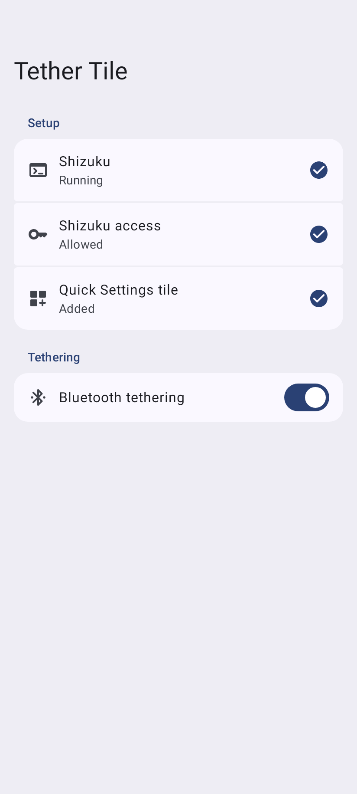
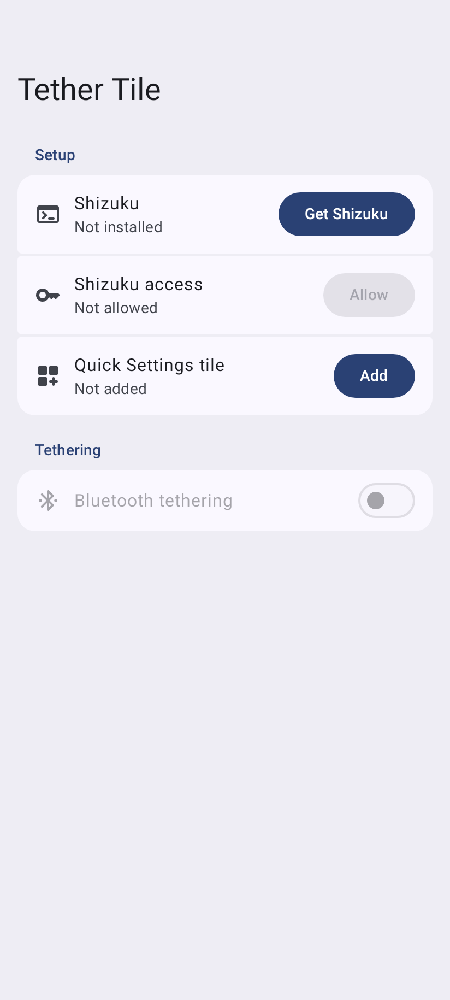
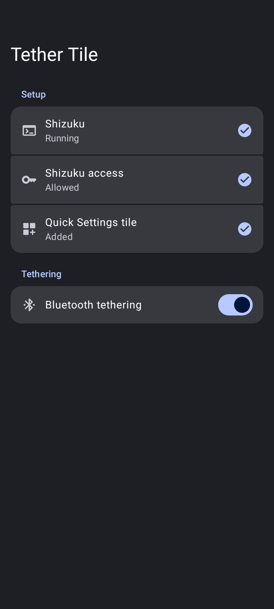

# Tether Tile

A Quick Settings tile for Bluetooth tethering on Android.

  
  
  

## Features

- Turns Bluetooth tethering on and off from Quick Settings, even on the lock screen.
- Turns on Bluetooth first if it's off, the same as the switch in Settings.
- Shows whether Bluetooth tethering is on, including when it was turned on in Settings.

Android only lets system apps switch tethering. Tether Tile does it through [Shizuku](https://shizuku.rikka.app/), and the tile only works while Shizuku is running. Shizuku stops when the phone restarts, and you'll need to start it again from the Shizuku app.

## How to use

1. Install Shizuku and start it. Their [setup guide](https://shizuku.rikka.app/guide/setup/) covers starting it with Wireless debugging, no computer needed.
2. Open Tether Tile and tap **Allow**, then **Add** to put the tile in Quick Settings.

If Shizuku isn't running, tapping the tile opens Tether Tile instead. That part needs the phone unlocked.

## Requirements

- Android 13 or later
- Shizuku

## How to build

You need JDK 17 and the Android SDK.

1. Clone this repository and open the directory.
2. Run `./gradlew assembleRelease`. The APK ends up in `app/build/outputs/apk/release/`.

`./gradlew testDebugUnitTest` saves pictures of the setup screen to `app/build/screenshots`.
